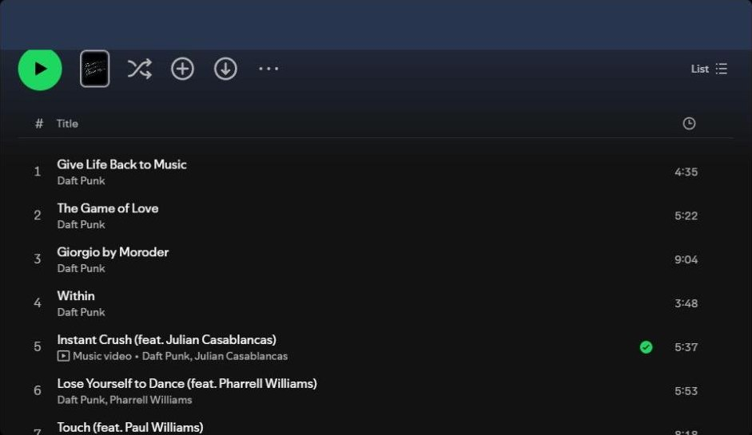
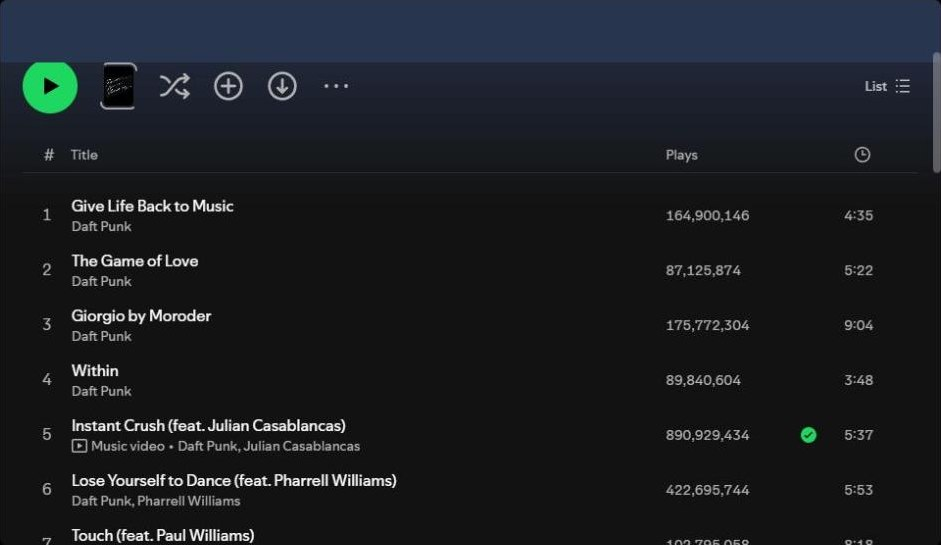
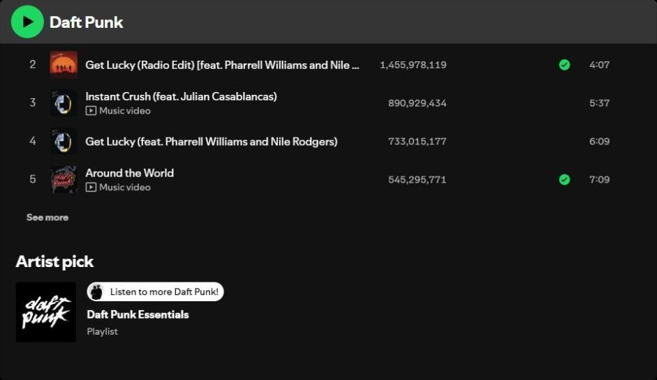
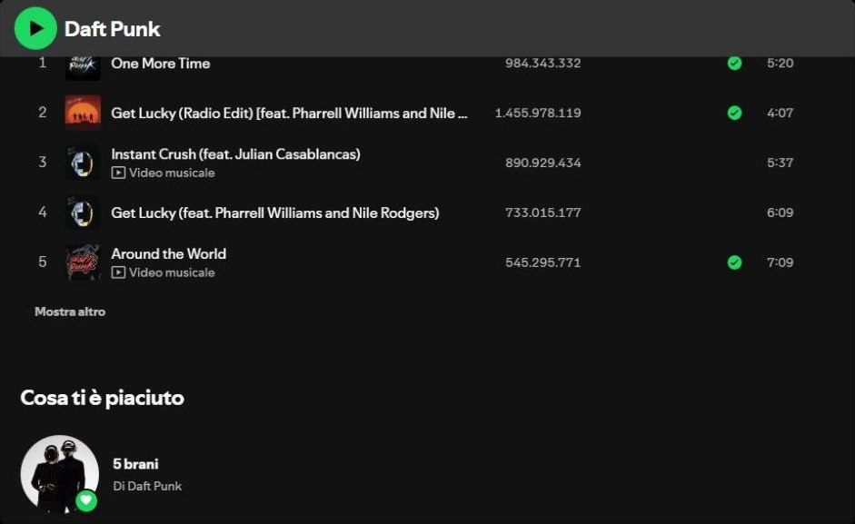
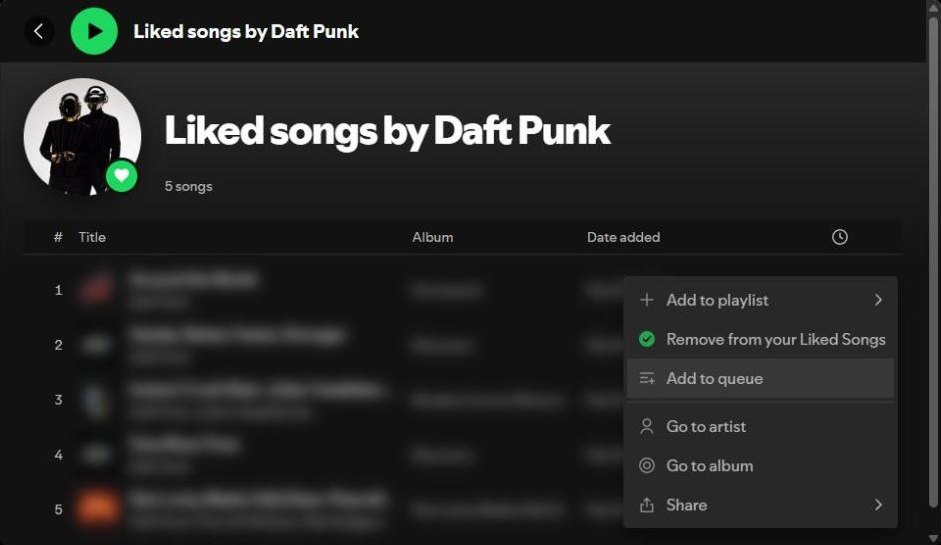
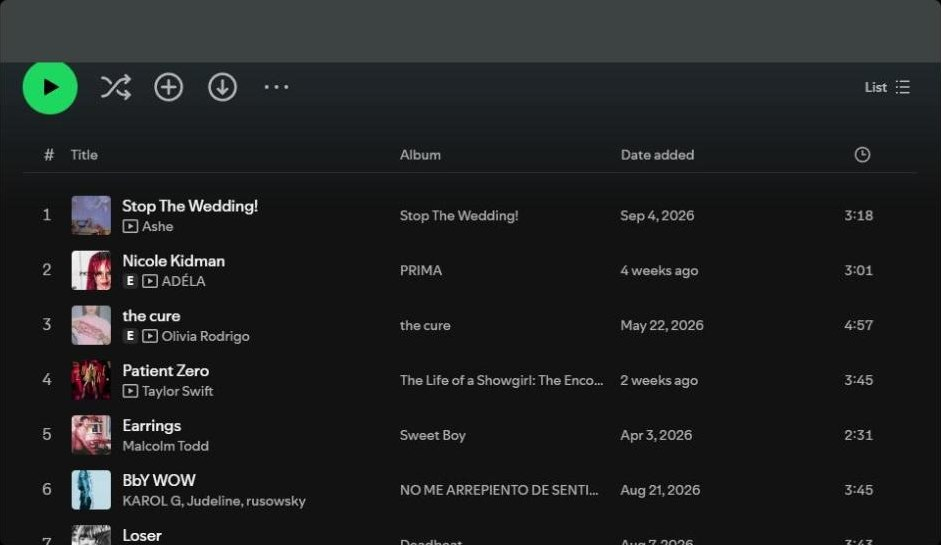
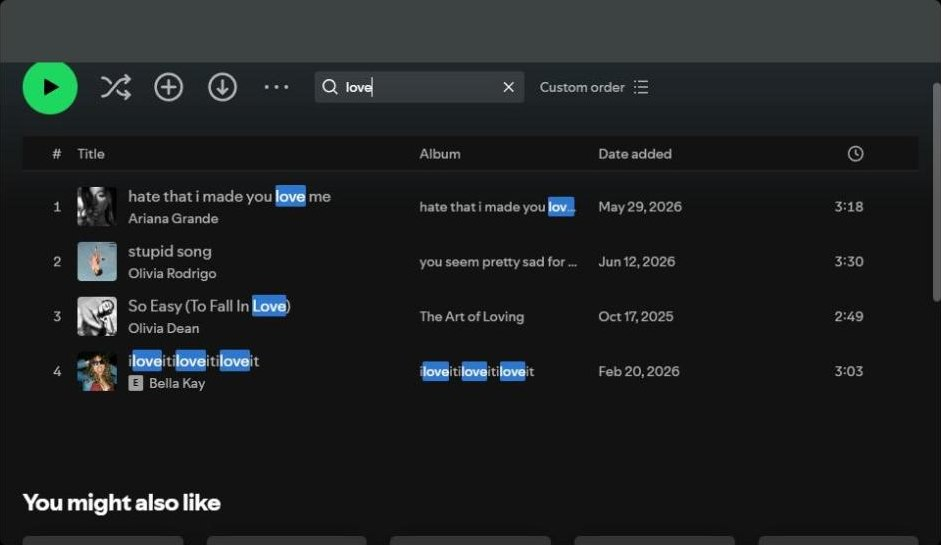
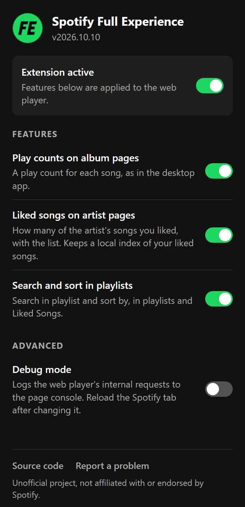

<p align="center"></p>

<h1 align="center">Full Experience for Spotify</h1>

<p align="center">A browser extension that adds to the Spotify web player some of what only the desktop app has.<br>It runs on Chrome, Brave, Edge and Firefox.</p>

> This is an unofficial project for personal use. It is not affiliated with, endorsed by or sponsored by Spotify, and "Spotify" is a trademark of Spotify AB. The extension relies on undocumented parts of the web player, which can change at any time.

## Features

I blurred my own songs in the screenshots.

### Play counts on album pages

| Before | After |
| --- | --- |
|  |  |

### Liked songs on artist pages

The artist page tells you how many of the artist's songs you liked. Like the desktop app, it counts only songs where they are the main artist. Click it to open the list.

| Before | After |
| --- | --- |
|  |  |

A double click plays a song, and each row has the desktop's menu: add to playlist, remove from liked songs, add to queue, go to artist or album, share.



### Search and sort in playlists and albums

You can search a playlist or Liked Songs, and sort it by title, artist, album, date added or duration. Albums can be searched too, and sorted by plays, title or duration (the desktop app cannot sort albums).

| Before | After |
| --- | --- |
|  |  |

### Settings



Click the extension icon to open the settings. One switch turns the whole extension off, and each feature has its own switch. Changes apply right away, except debug mode, which needs a reload of the Spotify tab.

The popup also links to the source code and to the issue tracker.

<br clear="right">

## Install

The extension is not on the stores yet. To try it, build it and load it unpacked (you need Node.js 20 or newer):

```sh
npm install
npm run build
```

In Chrome, Brave or Edge, open `chrome://extensions`, turn on Developer mode, click "Load unpacked" and pick `dist/chrome`.

In Firefox, open `about:debugging#/runtime/this-firefox`, click "Load Temporary Add-on" and pick `dist/firefox/manifest.json`. Firefox removes it when it restarts.

## Privacy

- The extension mostly reads what the web player already receives. When that is not enough, it asks Spotify through the player's own session, with a rate limit.
- There is no backend and no telemetry, and it only talks to the Spotify domains the player already uses. Tokens stay in memory and are never saved.
- Audio, DRM and ads are left alone, and Premium features stay locked.
- Play, queue, playlist and like actions run only when you click them.

The full [privacy policy](PRIVACY.md) explains what the extension reads and stores.

## Development

```sh
npm run watch       # rebuild on change
npm test
npm run typecheck
npm run package     # store zips in release/
```

To report a bug, [open an issue](https://github.com/fabrizio-ferrentino/spotify-full-experience/issues/new).

## Like it?

If it is useful to you, a star on GitHub helps other people discover it.

[](https://github.com/fabrizio-ferrentino/spotify-full-experience/stargazers)

## License

[MIT](LICENSE)
